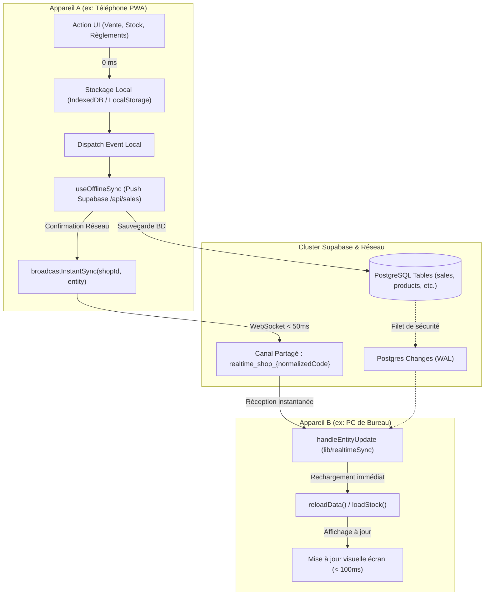

# 🏛️ Central SSOT Authority (Cahier Numérique)

Ce guide de compétence et ce registre d'architecture constituent l'**Autorité Suprême Unique de Vérité (Single Source of Truth - SSOT)** du projet.
Toute modification, création ou évolution technique sur ce dépôt **DOIT OBLIGATOIREMENT** s'aligner sur les modules canoniques et invariants définis ci-dessous.

---

## 🗺️ 1. Matrice des 11 Domaines Canoniques ("Single Source of Truth")

Chaque domaine technique dispose d'un **unique point d'entrée officiel**. Il est formellement interdit de réimplémenter ou contourner ces modules :

| # | Domaine Vital | Module Canonique | Fonctions / Objets Officiels | Règle d'Or |
|---|---|---|---|---|
| **1** | **Synchronisation Temps Réel** | `@/lib/realtimeSync` | `broadcastInstantSync(shopId, entity)`<br>`setupRealtimeSync(shopId, callbacks)`<br>`getRealtimeChannelName(shopId)` | Sub-seconde (< 50ms) via WebSocket Broadcast peer-to-peer + Postgres Changes en filet. Topic unifié par `normalizeShopCode`. |
| **2** | **Persistance & Sync Hors-Ligne** | `@/lib/offlineDb`<br>`@/lib/indexedDb`<br>`@/hooks/useOfflineSync` | `saveOfflineSale`, `getPendingSync`<br>`idbAddSyncItem`, `idbGetSyncQueue`<br>`useOfflineSync` | Écriture locale instantanée (0 ms). L'UI n'attend JAMAIS le réseau. `useOfflineSync` est l'unique passerelle réseau montante. |
| **3** | **Multi-Tenant & Codes Boutiques** | `@/lib/shopCodeUtils` | `getDualShopIds(shopId)`<br>`normalizeShopCode(shopId)`<br>`formatShortShopCode(shopId)` | Tolérance universelle des préfixes (`BTQ-`, `SHOP-`, UUID) avec résolution automatique multi-alias. |
| **4** | **Caisse, Tiroir & Billetage** | `@/lib/sales/cashDrawerCalculator` | `getCurrentCash(shopId)`<br>`calculateCash(salesList)`<br>`getItemCashDelta(item)` | Règle arithmétique stricte éliminant les arrondis flottants IEEE 754 et immunisée aux `NaN`. Calcul centralisé exclusif. |
| **5** | **Dettes & Réconciliation FIFO** | `@/hooks/useJournalData` | `reconcileDebts(sales)` | Apurement comptable FIFO strict par date d'ancienneté. Soldes bornés à `Math.max(0, ...)`. |
| **6** | **NLP Ventes & Multi-Paliers** | `@/lib/productUtils`<br>`@/lib/sales/offlineSaleParser` | `normalizeProductName`, `levenshteinDistance`<br>`parseTextLocally`, `findDuplicateCandidates` | Reconnaissance vocale et textuelle des conditionnements (carton complet, 1/2, 1/4, vrac au kg, lots dégressifs). |
| **7** | **Sécurité Backend, RLS & Rôles** | `@/lib/supabase`<br>`@/lib/supabaseClient`<br>`@/lib/server/shopAccess` | `isBackendSupabaseConfigured()`<br>`requireShopAccess`, `requireShopOwner`<br>`supabaseClient` | Service Role sanctuarisé au serveur. Anon Key protégée par RLS migration 022. Cloisonnement strict Patron vs Employé. |
| **8** | **PWA, Service Worker & Updates** | `@/components/pwa/PwaUpdateBanner`<br>`public/sw.js`<br>`public/manifest.json` | `PwaUpdateBanner`<br>`SKIP_WAITING`<br>`controllerchange` | Détection proactive (`visibilitychange`, `online`, intervalle 20 min). Rechargement à chaud sans perte de cache IndexedDB. |
| **9** | **Audit Anti-Fraude** | `@/lib/auditLogger` | `logAuditEvent({ shopId, action, targetId, details })` | Traçabilité inaltérable des annulations, retours et modifications avec bufferisation hors-ligne. |
| **10** | **Design & Motion Figma-Grade** | `.agents/rules/anti-ai-slop.md`<br>`.agents/skills/impeccable-ui-artisan` | Inset light biseauté (`inset 0 1px 0`)<br>`--ease-spring: cubic-bezier(0.16, 1, 0.3, 1)`<br>`active:scale-[0.97]`, `tabular-nums` | Zéro animation linéaire saccadée. Zéro dégradé violet/cyan fluo. Micro-interactions physiques tactiles. |
| **11** | **Télémétrie & Auto-Diagnostic** | `@/lib/errorDiagnostics`<br>`.agents/skills/telemetry-error-monitoring` | `translateErrorToPlainLanguage`<br>`captureAppError`, `copyErrorDiagnostics`<br>`generateWhatsAppErrorReportUrl` | Zéro message cryptique. Diagnostic traduit en français commerçant. 1-clic copie & WhatsApp. Zéro crash dans le logger. |

---

## ⚡ 2. Architecture de Synchronisation Multi-Appareils (PC <-> Téléphone)

Pour garantir une expérience collaborative temps réel parfaite entre le patron sur son PC et le vendeur sur smartphone :



### Règles d'or de la synchronisation :
1. **Topic Canonique Unique** : Tous les appareils utilisent `getRealtimeChannelName(shopId)`. Exemple : que l'appareil utilise `BTQ-58C54` ou `58C54`, le topic est invariablement `realtime_shop_58C54`.
2. **Anti-Écho par `deviceId`** : Chaque appareil possède son propre identifiant de session généré dans `sessionStorage` pour filtrer ses propres diffusions et éviter les boucles infinies de rechargement.
3. **Double Déclencheur (Broadcast + DB)** :
   - Le message Broadcast WebSocket déclenche l'actualisation en **30 à 80 ms**.
   - Supabase Postgres Changes garantit qu'aucune mutation n'est perdue si un appareil subit une micro-coupure.
   - Le polling de secours (15s) et l'écoute `visibilitychange` (déverrouillage de l'écran) sécurisent les retours de veille.

---

## 🛡️ 3. Protocole Obligatoire de Développement ("Guard Protocol")

Avant de soumettre ou commiter du code sur ce projet, chaque développeur ou agent d'IA **DOIT RESPECTER CETTE CHECKLIST** :

1. **Vérification d'existence ("Search First")** :
   ```bash
   git grep "<fonction_ou_concept>"
   ```
   Interdiction de réécrire une fonction existante dans un sous-fichier.

2. **Validation des tests automatisés** :
   ```bash
   npm test
   ```
   Doit valider sans avertissement :
   - `scripts/guard_anti_duplicate.ts` (0 composant orphelin, 0 duplication de route ou calcul)
   - `scripts/test_critical_suite.ts` (10/10 non-régression)
   - `scripts/test_employee_employer_sync.ts` (17/17 rôles & canaux temps réel)

3. **Validation de la compilation de production** :
   ```bash
   npm run build
   ```
   20/20 routes générées sans erreur TypeScript ni problème de directives (`'use client'`).

---

## 🚫 4. Ce qui est Formellement Proscrit ("Zero-Slop & Zero-Duplication")

- ❌ **Interdit** : Créer un fichier de script temporaire scratch suivi dans Git.
- ❌ **Interdit** : Réimplémenter `formatPrice`, `getCurrentCash`, `isBackendSupabaseConfigured`.
- ❌ **Interdit** : Ajouter des composants inutilisés ou obsolètes dans `components/`.
- ❌ **Interdit** : Utiliser des animations génériques saccadées `0.3s ease` ou des dégradés fluo non-Figma.
- ❌ **Interdit** : Altérer la migration SQL 022 ou bypasser l'authentification et les politiques RLS.

