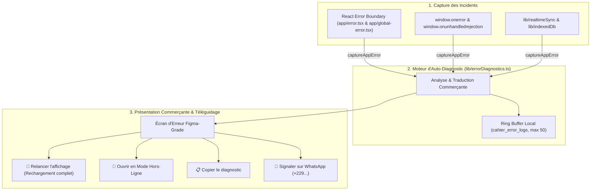

# 🩺 Telemetry & Error Self-Diagnostics Protocol

Ce guide de compétence définit le standard officiel de **télémétrie proactive, auto-diagnostic d'incidents et téléguidage commerçant** du projet Cahier Numérique.

Son objectif fondamental : **Aucun commerçant ne doit jamais se retrouver face à un écran blanc, une erreur bloquante muette ou un message cryptique incompréhensible.**

---

## 🏛️ 1. Principes Fondamentaux de Télémétrie Commerçante

1. **Zéro Jargon Cryptique pour l'Utilisateur** :
   Les messages comme `TypeError: Cannot read properties of undefined`, `Failed to fetch`, `PGRST301`, ou `QuotaExceededError` sont strictement bannis de l'interface principale. Chaque incident doit être immédiatement traduit en français simple décrivant la situation concrète (ex: *"Connexion internet interrompue"*, *"Mise à jour requise"*, *"Mémoire locale pleine"*).

2. **Sanctuaire des Données Locales** :
   Chaque écran ou bannière d'incident DOIT explicitement réaffirmer que **toutes les ventes, stocks et dettes enregistrés sur l'appareil sont 100% en sécurité**, éliminant toute angoisse de perte de données.

3. **Auto-Diagnostic & Signalement 1-Clic** :
   En cas de plantage ou d'interruption :
   - L'application compile automatiquement un rapport d'audit technique (horodatage, URL, mode en ligne/hors-ligne, code boutique, message système, digest React, statut Service Worker).
   - Un bouton **"📋 Copier le diagnostic"** copie ce rapport formaté dans le presse-papier.
   - Un bouton **"💬 Signaler sur WhatsApp"** ouvre WhatsApp avec le diagnostic pré-rempli pour une transmission instantanée au support technique.

4. **Résilience Absolue du Moteur de Télémétrie** :
   Le moteur de diagnostic (`lib/errorDiagnostics.ts`) **ne doit JAMAIS lever d'exception**. Toutes ses méthodes d'interception, de sérialisation et d'écriture locale sont enveloppées dans des blocs défensifs `try / catch`.

5. **Journalisation Locale Circulaire (Ring Buffer)** :
   Les 50 dernières erreurs sont enregistrées localement (`localStorage` sous la clé `cahier_error_logs`). Les logs survivent au rechargement de la page et permettent d'analyser les incidents passés même lorsque l'appareil est hors-ligne.

---

## 🗺️ 2. Matrice de Traduction Commerçante (Taxonomie des Erreurs)

Le moteur canonique `@/lib/errorDiagnostics` classe toute anomalie dans l'une des 6 catégories suivantes :

| Catégorie | Déclencheurs Techniques | Titre Commerçant | Action Recommandée |
|---|---|---|---|
| **`network`** | `Failed to fetch`, `NetworkError`, `net::ERR_...`, timeout | Connexion internet coupée ou instable | Vérifier le Wi-Fi/4G. Continuer à saisir les ventes en **Mode Hors-Ligne**. |
| **`supabase_sync`** | `cannot add postgres_changes`, `PGRST...`, JWT expiré, WebSocket 1006 | Synchronisation serveur temporairement perturbée | Relancer l'affichage. Les données locales continuent de fonctionner à 100%. |
| **`storage`** | `QuotaExceededError`, `NS_ERROR_DOM_QUOTA_REACHED`, IDB error | Mémoire locale de l'appareil saturée | Libérer de l'espace sur le téléphone/PC ou fermer les fenêtres de navigation privée. |
| **`pwa_cache`** | `Loading chunk ... failed`, `CSS chunk`, version SW obsolète | Mise à jour de l'application disponible | Cliquer sur **"Actualiser"** pour charger la nouvelle version optimisée. |
| **`auth`** | `AuthSessionMissingError`, `Invalid Refresh Token` | Session expirée ou déconnectée | Se reconnecter à la boutique avec son mot de passe ou code d'accès. |
| **`runtime`** | Minified React error, digest Next.js, composant React corrompu | Interruption temporaire de l'affichage | Cliquer sur **"Relancer l'affichage"** ou basculer en mode hors-ligne. |

---

## 🛠️ 3. Architecture d'Intégration Logicielle



---

## 📋 4. Règles d'Implémentation & Invariants

1. **Rechargement Réel** :
   Ne jamais se fier uniquement au `reset()` en mémoire de React Next.js lors d'un plantage d'affichage. La fonction `handleReload` DOIT exécuter `window.location.reload()`, et notifier le Service Worker (`SKIP_WAITING`) si une version plus récente est en attente.

2. **Secours Hors-Ligne Garanti** :
   Tout écran d'erreur DOIT fournir un accès direct à `/journal?offline=true` en stockant `sessionStorage.setItem('cahier_force_offline', 'true')` afin que le boutiquier puisse encaisser ses clients sans blocage.

3. **Format du Rapport WhatsApp** :
   Le message WhatsApp généré doit être clair, concis et préformaté :
   ```text
   🚨 *SIGNALEMENT INCIDENT - CAHIER NUMÉRIQUE*
   📅 Date : 02/11/2026 à 01:45
   🏪 Boutique : BTQ-7681
   🏷️ Catégorie : Synchronisation serveur
   💡 Diagnostic : Synchronisation temporairement interrompue
   🔍 Erreur : cannot add postgres_changes callbacks...
   🌐 Réseau : En ligne (4G/Wi-Fi)
   📱 Appareil : Mozilla/5.0 (Windows NT 10.0; Win64; x64)...
   ```

4. **Vérification Continue dans les Tests** :
   Le script de contrôle `scripts/guard_anti_duplicate.ts` et la suite de résilience `scripts/test_deep_resilience.ts` doivent valider en permanence la présence et l'intégrité de `@/lib/errorDiagnostics` et de ce skill.

